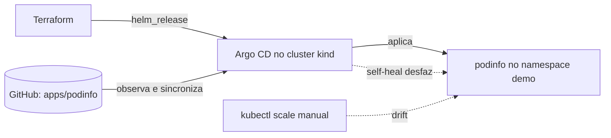

# k8s-gitops-lab

Kubernetes local (kind) com **Terraform** instalando o **Argo CD** via **Helm**, e o Argo CD fazendo o deploy de uma aplicação direto deste repositório (**GitOps**). Sem custo de nuvem: tudo roda no notebook.



| Camada | Ferramenta | Quem muda |
|---|---|---|
| Cluster | kind | `kind create cluster` |
| Plataforma | Terraform + Helm (Argo CD) | `terraform apply` |
| Aplicação | Argo CD lendo `apps/podinfo` | `git push` |

## Instalar as ferramentas (WSL / Ubuntu)

```bash
# kind
curl -Lo kind https://kind.sigs.k8s.io/dl/v0.33.0/kind-linux-amd64 && chmod +x kind && sudo mv kind /usr/local/bin/
# kubectl
curl -LO "https://dl.k8s.io/release/$(curl -Ls https://dl.k8s.io/release/stable.txt)/bin/linux/amd64/kubectl"
sudo install -m 0755 kubectl /usr/local/bin/kubectl && rm kubectl
# helm (CLI, para inspecionar)
curl -fsSL https://raw.githubusercontent.com/helm/helm/main/scripts/get-helm-3 | bash
# terraform
wget -qO- https://apt.releases.hashicorp.com/gpg | sudo gpg --dearmor -o /usr/share/keyrings/hashicorp-archive-keyring.gpg
echo "deb [signed-by=/usr/share/keyrings/hashicorp-archive-keyring.gpg] https://apt.releases.hashicorp.com $(lsb_release -cs) main" | sudo tee /etc/apt/sources.list.d/hashicorp.list
sudo apt update && sudo apt install -y terraform

kind version && kubectl version --client && helm version --short && terraform version
```

## Subir

```bash
cd labs/k8s-gitops-lab
kind create cluster --name gitops          # ~1 min
cd terraform
terraform init
terraform plan                             # leia o que vai ser criado
terraform apply                            # ~3 min (instala o Argo CD e a Application)
kubectl -n argocd get pods
kubectl -n demo get pods                   # 2 pods do podinfo, criados pelo Argo CD
```

Painel do Argo CD: `kubectl -n argocd port-forward svc/argocd-server 8080:80` e abra http://localhost:8080 (usuário `admin`, senha: comando no `terraform output`).

Aplicação: `kubectl -n demo port-forward svc/podinfo 9898:9898` e abra http://localhost:9898.

## Exercícios (e o que dizer na entrevista)

### 1. Deploy por Git
Mude `replicas: 2` para `3` em `apps/podinfo/deployment.yaml`, faça commit e push. Em até 3 minutos (ou **Refresh** no painel) o Argo CD aplica.

> "No GitOps ninguém roda `kubectl apply` em produção: a mudança é um PR revisado, e o Argo CD reconcilia o cluster com o Git. O histórico do Git vira a auditoria e o rollback é um `git revert`."

### 2. Drift e self-heal
```bash
kubectl -n demo scale deploy podinfo --replicas=1
kubectl -n demo get pods -w        # em segundos volta para 3
```
> "Com `selfHeal`, mudança manual é tratada como drift e desfeita. É o mesmo conceito do meu netlab, em que o NetBox é a fonte da verdade e o drift aponta o que mudou fora do pipeline."

### 3. Troubleshooting: ImagePullBackOff
Troque a imagem para uma tag que não existe (`podinfo:9.9.9`), push, e investigue:
```bash
kubectl -n demo get pods
kubectl -n demo describe pod <pod>   # veja os Events no fim
```
Corrija com `git revert HEAD && git push`.

> "Meu roteiro: `get pods` para ver o estado, `describe` para os eventos, `logs --previous` para o container que caiu. ImagePullBackOff é imagem ou credencial do registry; CrashLoopBackOff é a aplicação caindo; OOMKilled é limite de memória; Pending é falta de recurso ou taint. Durante o rolling update os pods antigos continuam servindo, por causa da readiness probe."

### 4. Requests, limits e probes
Leia `deployment.yaml`: `requests` reservam CPU e memória no agendamento, `limits` são o teto, a `readinessProbe` tira o pod do Service até ficar pronto e a `livenessProbe` reinicia se travar.
```bash
kubectl -n demo top pods 2>/dev/null || echo "kind não traz metrics-server; HPA precisaria dele"
```
> "Requests bem calibrados são FinOps: o autoscaler de nós (Karpenter na AWS) dimensiona as máquinas pelos requests. Superdimensionar é pagar por capacidade ociosa."

### 5. Terraform: plan, state e mudança
```bash
cd terraform
terraform state list                       # o que o Terraform gerencia
terraform plan -var argocd_chart_version=10.19.1   # veja o diff antes de aplicar
```
> "O state é a memória do Terraform. Em equipe ele fica num backend remoto com lock, nunca no Git, porque pode ter segredo. O `plan` roda no PR, alguém revisa, e o `apply` acontece depois do merge. `terraform import` traz para o código um recurso criado na mão."

## Limpar
```bash
kind delete cluster --name gitops
```

## Do lab para a produção

| Aqui | Em produção |
|---|---|
| kind | EKS (AWS) ou OKE (OCI) |
| state local | backend remoto com lock |
| `server.insecure` + port-forward | Ingress com TLS (cert-manager) e SSO |
| senha inicial do admin | SSO e RBAC do Argo CD |
| Secret em YAML | External Secrets lendo Secrets Manager ou OCI Vault |
| réplicas fixas | HPA (CPU) ou KEDA (fila, eventos) e Karpenter para os nós |
