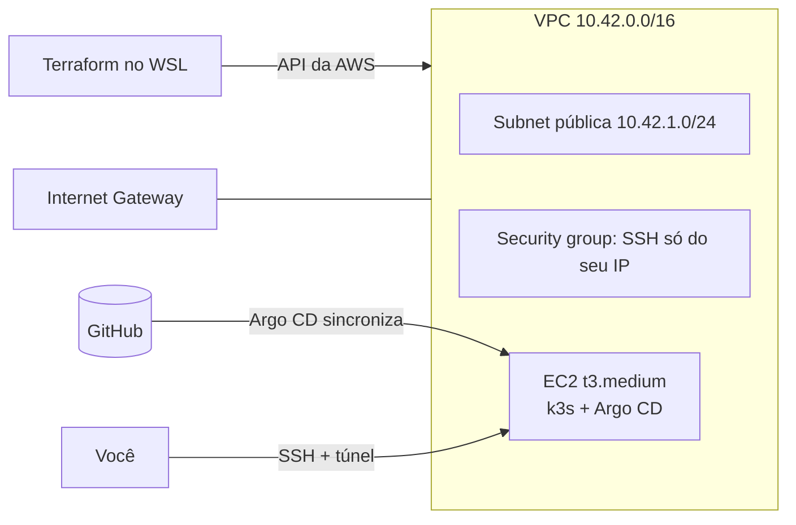

# k8s-gitops-lab na AWS

Terraform cria a rede e uma EC2; no primeiro boot, a EC2 instala **k3s** (Kubernetes leve), o **Argo CD** e a Application que faz o deploy do `podinfo` a partir deste repositório.



Custo: t3.medium ~US$ 0,04/h, mais o disco de 20 GB, coberto pelos créditos. **Rode `terraform destroy` no fim.**

---

## Passo 0. Conta, credenciais e proteção de custo

Conta AWS própria no plano gratuito (créditos), região **Ohio (us-east-2)**.

**0.1 Alerta de gasto (FinOps, 1 minuto).** Console > **Billing and Cost Management > Budgets > Create budget > Use a template > Zero spend budget**, com o seu e-mail. Avisa se algo começar a cobrar fora dos créditos.

**0.2 Usuário para o Terraform.** Nunca crie chave de acesso para o root.
1. Console > **IAM > Users > Create user**: nome `terraform-lab`, **sem** acesso ao console.
2. **Attach policies directly**: `PowerUserAccess` (tudo menos IAM; o lab não cria IAM).
3. Abra o usuário > **Security credentials > Create access key > Command Line Interface (CLI)**. Copie a Access key e a Secret.

```bash
mkdir -p ~/.aws && chmod 700 ~/.aws
cat > ~/.aws/credentials <<'EOF'
[default]
aws_access_key_id = COLE_AQUI
aws_secret_access_key = COLE_AQUI
EOF
chmod 600 ~/.aws/credentials
nano ~/.aws/credentials        # troque os COLE_AQUI e salve
```

**0.3 Chave SSH.** O Terraform cadastra a sua chave pública (`~/.ssh/netlab.pub`) como key pair; a privada nunca sai do PC.

```bash
ls ~/.ssh/netlab ~/.ssh/netlab.pub
```

> **Entrevista:** "Usei um usuário IAM só para o Terraform, com política sem acesso a IAM, e chave de acesso que eu apago no fim. Na empresa o ideal é nem ter chave fixa: SSO para pessoas e OIDC do GitHub Actions assumindo uma role para o pipeline. E sempre um budget com alerta."

**No fim do lab:** `terraform destroy` e **desative a access key** do `terraform-lab` (IAM > Users > Security credentials).

## Passo 1. Variáveis e `init`

```bash
cd ~/portfolio-devops/labs/k8s-gitops-lab/aws
cp terraform.tfvars.example terraform.tfvars
sed -i "s|203.0.113.10/32|$(curl -s ifconfig.me)/32|" terraform.tfvars
cat terraform.tfvars
terraform init
```

**O que acontece:** o `init` baixa o **provider** da AWS (o plugin que traduz o código em chamadas de API) e cria a pasta `.terraform/`. O `.terraform.lock.hcl` fixa a versão exata do provider.

| Conceito | Onde está | O que é |
|---|---|---|
| **provider** | `versions.tf` | plugin que fala com a API (aws, helm, kubernetes...) |
| **variable** | `variables.tf` | entrada; tem tipo, default e **validação** (veja o `my_ip_cidr`) |
| **tfvars** | `terraform.tfvars` | valores das variáveis desta execução (fora do Git) |
| **default_tags** | `versions.tf` | tag em tudo: saber de quem é e quanto custa |

---

## Passo 2. `plan`: ler antes de mudar

```bash
terraform plan
```

Leia a saída: `+ create` em cada recurso, e o resumo `Plan: 10 to add, 0 to change, 0 to destroy`.

| Recurso | Para que serve |
|---|---|
| `aws_vpc` | rede isolada do lab (10.42.0.0/16) |
| `aws_internet_gateway` | saída para a internet |
| `aws_subnet` (pública) | onde a EC2 fica; pública porque a rota padrão vai para o IGW |
| `aws_route_table` + association | a rota `0.0.0.0/0 -> IGW` |
| `aws_security_group` + regras | firewall **stateful**: entra só SSH do seu IP; a saída é livre |
| `aws_key_pair` | sua chave pública cadastrada na AWS |
| `aws_instance` | a EC2 com k3s |
| `data.aws_ami` | **data source**: consulta a AMI Ubuntu mais nova, não cria nada |

> **Entrevista:** "O Terraform monta um grafo de dependências pelas referências: a subnet usa `aws_vpc.lab.id`, então a VPC é criada antes. O `plan` mostra exatamente o que vai mudar; no time, ele roda no PR e alguém revisa antes do `apply`."

---

## Passo 3. `apply`

```bash
terraform apply        # digite yes
terraform output
```

Leva ~1 minuto para criar a infraestrutura. O cloud-init dentro da EC2 ainda leva **~5 minutos** instalando k3s e Argo CD.

Agora existe o **state** (`terraform.tfstate`): a memória do Terraform, que liga cada recurso do código ao ID real na AWS.

```bash
terraform state list
terraform state show aws_instance.k3s | head -20
```

> **Entrevista:** "O state é a fonte de verdade do Terraform sobre o que ele gerencia. Em equipe ele fica num backend remoto (S3 com lock), nunca no Git, porque pode ter dado sensível. Se alguém muda algo na mão pelo console, o próximo `plan` mostra o drift."

---

## Passo 4. Entrar na EC2 e ver o Kubernetes

```bash
$(terraform output -raw ssh)                       # entra na EC2
sudo tail -f /var/log/netlab-bootstrap.log         # espere "BOOTSTRAP OK" e saia com Ctrl+C
kubectl get nodes
kubectl get pods -A
kubectl -n demo get pods,svc
```

| Objeto | O que você vê |
|---|---|
| **Node** | a EC2 como nó do cluster |
| **Namespace** | `argocd`, `demo`, `kube-system`: separação lógica |
| **Pod** | os containers rodando (2 do podinfo) |
| **Deployment** | mantém as 2 réplicas e faz rolling update |
| **Service** | endereço fixo (ClusterIP) na frente dos pods |

> **Entrevista:** "k3s é um Kubernetes certificado e leve. Em produção na AWS eu usaria o EKS: a AWS gerencia o control plane e eu cuido dos nós (managed node groups ou Karpenter). Os objetos e o kubectl são os mesmos."

---

## Passo 5. Argo CD e GitOps

Num terminal **novo** no WSL:

```bash
cd ~/portfolio-devops/labs/k8s-gitops-lab/aws
eval "$(terraform output -raw tunel_argocd)"
```

Abra http://localhost:8080. Usuário `admin`; senha (na EC2):

```bash
kubectl -n argocd get secret argocd-initial-admin-secret -o jsonpath='{.data.password}' | base64 -d; echo
```

Agora faça os exercícios do [README do lab](../README.md): réplicas pelo Git, self-heal (`kubectl -n demo scale deploy podinfo --replicas=1`), ImagePullBackOff e rollback com `git revert`.

> **Entrevista:** "Repare que nem a API do Kubernetes nem o Argo CD estão expostos: o security group só libera SSH do meu IP e eu acesso por túnel. Na produção seria Ingress com TLS e SSO, ou acesso via VPN ou SSM."

---

## Passo 6. Ver drift do Terraform (2 minutos)

No console da AWS, em **EC2 > Instances > netlab-k3s > Tags**, adicione uma tag `Teste=manual`. Depois:

```bash
terraform plan
```

O plano mostra a tag a remover: é o Terraform detectando mudança feita fora do código. `terraform apply` volta ao estado declarado.

---

## Passo 7. Destruir (sempre)

```bash
terraform destroy      # digite yes
```

> **Entrevista (FinOps):** "Ambiente de estudo e de teste se destrói quando não está em uso; com IaC, recriar leva minutos. Fora isso: tags para atribuir custo, rightsizing, desligar ambientes ociosos fora do horário, spot para cargas tolerantes e reservas ou savings plans para a base fixa."

---

## Problemas comuns

| Erro | Causa | Solução |
|---|---|---|
| `InvalidClientTokenId` / `SignatureDoesNotMatch` | chave copiada errada | confira `~/.aws/credentials` (sem espaços extras) |
| `no such file` em `netlab.pub` | caminho da chave | ajuste `ssh_public_key_path` no `terraform.tfvars` |
| instância "not eligible" para o plano gratuito | restrição do plano | use `instance_type = "t3.small"` no tfvars |
| SSH com timeout | seu IP mudou | atualize `terraform.tfvars` e rode `terraform apply` |
| `kubectl` sem pods do podinfo | o bootstrap ainda está rodando | acompanhe `/var/log/netlab-bootstrap.log` |

---

### Usando o AWS Academy (Learner Lab) em vez de conta própria

No `terraform.tfvars`: `region = "us-east-1"` e `instance_profile = "LabInstanceProfile"`. As credenciais vêm de **AWS Details > AWS CLI > Show** (temporárias, com session token).
