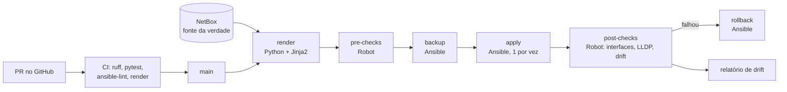
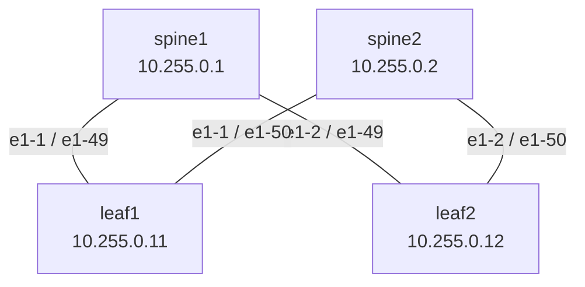
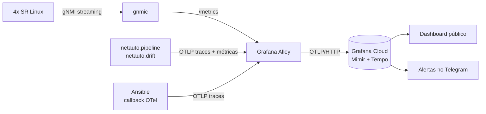

# netauto-lab

Lab de **automação de rede** com o fluxo usado em data center: o **NetBox** diz como a rede deve ser,
o código transforma isso em configuração, o **Ansible** aplica, o **Robot Framework** confere antes e
depois, e um verificador de **drift** avisa quando alguém mexe na rede fora do pipeline.

Tudo roda num fabric spine-leaf de **Nokia SR Linux** no containerlab (imagem pública, sem licença).



## O que este lab demonstra

| Requisito | Onde está |
|---|---|
| NetBox como fonte da verdade | `netauto/seed.py` (popular), `netauto/netbox_client.py` (ler), inventário dinâmico `ansible/inventory/netbox.yml` |
| Python com Requests/HTTPX | `netbox_client.py` (paginação, retry com backoff, `ensure` idempotente) e `srl_client.py` (JSON-RPC do SR Linux) |
| Ansible para mudança | `ansible/playbooks/`: backup, apply com `serial: 1` e `--diff`, rollback por `replace` |
| Pre/post-checks com Robot Framework | `robot/`: acesso, interfaces up, **cabeamento real (LLDP) contra os cabos do NetBox**, sem drift |
| Drift detection | `netauto/drift.py`: compara intenção x running, aponta `missing`, `changed` e `extra` |
| Git, PR e code review | o CI publica a configuração gerada (formato CLI) no resumo do PR, para revisar a mudança de rede e não só o código |
| Rastreabilidade e recuperação | logs JSON com `run_id` + commit, backup por execução, artefatos de 30 dias, rollback automático |
| pytest | 40 testes que rodam sem equipamento (httpx `MockTransport`, runner falso para o pipeline) |
| Observabilidade | telemetria gNMI, traces OpenTelemetry do pipeline e do Ansible, métricas de drift, Grafana Cloud e alertas: veja [Observabilidade](#observabilidade) |
| Validação real | pipeline executado contra o lab: veja [Resultado validado](#resultado-validado) |

## Topologia



Enlaces ponto a ponto em /31 (`10.0.0.0/31` a `10.0.0.6/31`), loopback em `system0`,
gerência em `172.30.30.0/24`. Os dados de partida estão em `data/fabric.yml`.

## Como rodar

Pré-requisitos: Linux ou WSL2 com Docker, [containerlab](https://containerlab.dev/install/), Python 3.11+
e **8 GB de RAM** livres (cada SR Linux usa cerca de 1,5 GB).

```bash
cd labs/netauto-lab
make venv collections        # Python + coleções Ansible

make lab-up                  # 4 SR Linux no containerlab
make netbox-up               # NetBox em http://localhost:8000 (siga as instruções do script)

export NETBOX_URL=http://localhost:8000
export NETBOX_TOKEN=<token gerado no NetBox>
export SRL_PASSWORD='NokiaSrl1!'   # senha padrão do SR Linux no containerlab, só para o lab

make seed                    # fabric.yml -> NetBox (pode rodar quantas vezes quiser)
make deploy                  # render, pre-checks, backup, apply, post-checks (rollback se falhar)
make drift                   # build/drift/report.json
```

Para ver o drift funcionando, mude algo direto no equipamento e rode `make drift`:

```bash
ssh admin@172.30.30.21   # leaf1
# enter candidate
# set / interface ethernet-1/49 description "mexeram aqui"
# commit now
```

Para ver o rollback: `make rollback RUN_ID=<run_id do backup>` (os arquivos ficam em `build/backups/`).

Sem lab no ar, dá para trabalhar só com os testes e o render a partir do YAML:

```bash
make test
.venv/bin/python -m netauto.render --source file && cat build/intents/leaf1.cli
```

## Resultado validado

Executado contra o lab real (4× SR Linux 24.10.1 no containerlab 0.82 + NetBox 4.7), não só no CI.

### 1. Antes e depois no leaf1

Antes do pipeline, as portas tinham cabo e estavam up, mas sem nenhuma configuração:

```
ethernet-1/49 is up, speed 100G
ethernet-1/50 is up, speed 100G
Summary
  0 loopback interfaces configured
  1 subinterfaces are up          # só a gerência
```

Depois do `make deploy`, tudo vindo do NetBox:

```
ethernet-1/49.0 is up   Network-instance: default   IPv4 addr: 10.0.0.1/31
ethernet-1/50.0 is up   Network-instance: default   IPv4 addr: 10.0.0.5/31
system0.0 is up         Network-instance: default   IPv4 addr: 10.255.0.11/32
Summary
  4 subinterfaces are up
```

O leaf1 alcança o spine1 pelo /31:

```
A:leaf1# ping 10.0.0.0 network-instance default -c 3
3 packets transmitted, 3 received, 0% packet loss
```

### 2. Pipeline completo (`make deploy`)

| Etapa | Resultado |
|---|---|
| Seed no NetBox | 1 site, 4 devices, 12 IPs, 4 cabos. Na segunda execução, nada criado (idempotente) |
| Render | intenção dos 4 equipamentos, idêntica à gerada a partir do YAML |
| Pre-checks (Robot) | 2/2 PASS: intenção gerada, equipamentos respondendo via JSON-RPC |
| Backup (Ansible) | running dos 4 salva em `build/backups/<host>-<run_id>.json` |
| Apply (Ansible) | `changed=1` em cada equipamento, aplicado um por vez, com diff |
| Post-checks (Robot) | 3/3 PASS: interfaces up, **LLDP igual aos cabos do NetBox**, sem drift |
| Apply de novo | `changed=0` nos 4 (idempotente) |

### 3. Drift: detectar e corrigir

Alteração feita direto no equipamento, fora do pipeline:

```
A:leaf1# enter candidate
set / interface ethernet-1/49 description "mexeram aqui"
commit now
```

`make drift` detecta, aponta o campo exato e sai com código 2:

```json
{
  "run_id": "20261103-234146",
  "commit": "1e7662a",
  "hosts": {
    "leaf1": {
      "drift": [
        {
          "path": "/interface[name=ethernet-1/49]/description",
          "kind": "changed",
          "expected": "to spine1 ethernet-1/1",
          "actual": "mexeram aqui"
        }
      ]
    },
    "leaf2": { "drift": [] },
    "spine1": { "drift": [] },
    "spine2": { "drift": [] }
  }
}
```

`make apply` reconcilia só o que divergiu, sem tocar nos outros equipamentos:

```
TASK [Aplicar (merge) a intenção]
      interface ethernet-1/49 {
-         description "mexeram aqui"
+         description "to spine1 ethernet-1/1"
      }
changed: [leaf1]

leaf1  : changed=1
leaf2  : changed=0
spine1 : changed=0
spine2 : changed=0
```

E o `make drift` seguinte volta para código 0: a rede está igual ao NetBox.

### 4. O que o teste real encontrou

O CI passava, mas dois problemas só apareceram na execução contra o lab. Os dois foram corrigidos via PR:

- **`group_vars` no lugar errado.** O Ansible só carrega `group_vars` ao lado do inventário ou do playbook; ele estava em `ansible/`. O lint e o syntax-check não pegam isso, porque não resolvem variáveis. A pasta foi movida para `ansible/inventory/group_vars/`.
- **Dependência faltando.** O inventário dinâmico do NetBox exige `pytz`, e as coleções de rede usam `netaddr`. Os dois foram adicionados ao `requirements.txt`.

Lição: testes de unidade e lint são necessários, mas não substituem uma execução contra o ambiente real. É para isso que serve o lab.

## Observabilidade

A rede e o próprio processo de automação são observados, e tudo fica visível num dashboard público no Grafana Cloud.



| Sinal | De onde vem | O que mostra |
|---|---|---|
| Telemetria da rede | gNMI dos SR Linux, coletado pelo **gnmic** | estado das portas, tráfego, erros, CPU e memória |
| Traces do pipeline | **OpenTelemetry** no `netauto.pipeline` | um trace por deploy: render → pre-checks → backup → apply → post-checks → drift |
| Traces do Ansible | callback `community.general.opentelemetry` | cada task do Ansible como span **dentro do mesmo trace** (via `TRACEPARENT`) |
| Métricas de automação | OpenTelemetry no `netauto.drift` e no pipeline | `netauto_drift_items`, `netauto_drift_reachable`, `netauto_pipeline_runs_total`, duração do último deploy |

O **Grafana Alloy** é o único agente: recebe OTLP do Python e do Ansible, raspa o gnmic e envia tudo para o Grafana Cloud com uma credencial só. Sem a variável `OTEL_EXPORTER_OTLP_ENDPOINT`, a instrumentação fica desligada (no-op), então o CI e os testes não dependem de nada disso.

### Como ligar

1. Crie uma conta gratuita no [Grafana Cloud](https://grafana.com/products/cloud/). Na sua stack, vá em **Connections > OpenTelemetry (OTLP)** e anote o **endpoint** e o **Instance ID**. Gere um token com escopo de escrita.
2. Configure e suba o monitoramento (depois do `make lab-up`):

   ```bash
   cp monitoring/.env.example monitoring/.env   # preencha; o .env fica fora do Git
   make mon-up
   export OTEL_EXPORTER_OTLP_ENDPOINT=http://localhost:4318
   make deploy                                  # agora gera traces e métricas
   make drift-watch                             # drift a cada 5 min (Ctrl+C para parar)
   ```

3. No Grafana Cloud, vá em **Dashboards > New > Import** e envie `monitoring/grafana/netauto-dashboard.json`.
4. Para deixar público: no dashboard, use **Share > Share externally** e copie o link.

Para conferir se o Alloy está recebendo: abra http://localhost:12345 (a UI do Alloy) ou rode `curl -s localhost:12345/metrics | grep accepted`.

### Alertas

Configure no Grafana Cloud em **Alerting > Contact points** (tipo Telegram, com o token do bot e o chat ID) e crie as regras:

| Alerta | Consulta | Condição |
|---|---|---|
| Drift detectado | `max by (host) (netauto_drift_items)` | `> 0` por 1 min |
| Equipamento inacessível | `min by (host) (netauto_drift_reachable)` | `< 1` por 5 min |
| Verificação de drift parada | `time() - max(netauto_drift_last_run_seconds)` | `> 900` |
| Porta da fábrica caiu | `srl_interface_oper_state{interface_name=~"ethernet-.*"}` | `< 1` por 1 min |
| Deploy falhou | `max(netauto_pipeline_last_success{pipeline="deploy"})` | `< 1` |

### Custos e limites

- Memória extra no lab: cerca de 350 MB (gnmic limitado a 128 MB e Alloy a 256 MB no compose).
- O plano gratuito do Grafana Cloud cobre o volume do lab com folga: são poucas séries e poucos traces.
- O dashboard mostra dados ao vivo **só enquanto o lab estiver ligado**; o histórico fica guardado conforme a retenção do plano.

## Rodar na nuvem (DigitalOcean, sob demanda)

Para demos e entrevistas sem pesar o PC: sobe um droplet, roda um script e destrói depois. Cobra só pelas horas em que o droplet existir.

1. Crie um droplet **Ubuntu 24.04** com **16 GB de RAM / 4+ vCPU** e a sua chave SSH.
2. No droplet:

   ```bash
   ssh root@<ip-do-droplet>
   git clone https://github.com/Alerpina/netlab.git /opt/netlab
   cd /opt/netlab/labs/netauto-lab
   GRAFANA_CLOUD_OTLP_ENDPOINT=https://otlp-gateway-prod-sa-east-1.grafana.net/otlp \
   GRAFANA_CLOUD_INSTANCE_ID=<instance id> \
   ./scripts/bootstrap-droplet.sh          # pede o token do Grafana sem mostrar na tela
   ```

   Em uns 15 minutos o script instala Docker e containerlab, sobe a fábrica e o NetBox, cria o usuário e o token do NetBox sozinho, roda seed e deploy, liga o monitoramento e deixa o drift rodando a cada 5 minutos (serviço `netauto-drift`).
3. NetBox pelo túnel SSH: `ssh -L 8000:localhost:8000 root@<ip>` e abra http://localhost:8000 (senha em `build/lab.env`).
4. Terminou? **Destrua o droplet** no painel. Desligar não para a cobrança. O histórico continua no Grafana Cloud.

Só o SSH fica aberto: NetBox e Alloy escutam em `127.0.0.1`, e os dados saem para o Grafana Cloud por conexão de saída.

## Pipeline no GitHub Actions

- **`netauto-ci.yml`** (todo PR): ruff, pytest, render, Robot dry-run, ansible-lint e syntax-check.
  A configuração gerada aparece no resumo do job.
- **`netauto-deploy.yml`** (manual): roda num **runner self-hosted** com label `netauto-lab`, na máquina
  do lab. Pede a palavra `APLICAR`, vem em modo simulação por padrão, faz rollback se o post-check falhar
  e guarda tudo (`build/`) como artefato.
- **`netauto-drift.yml`** (manual, com agendamento pronto para ligar): falha quando a rede diverge do NetBox.

Segredos do repositório: `NETBOX_TOKEN` e `SRL_PASSWORD`. Variáveis: `NETBOX_URL` e `SRL_USER`.

## Decisões

- **Intenção como dado, não como template de texto.** O render gera `{path, value}` para o JSON-RPC
  do SR Linux. Isso é testável com `==` e é exatamente o que o módulo `nokia.srlinux.config` recebe.
  O arquivo `.cli` existe só para leitura humana no PR.
- **Merge no apply, replace no rollback.** O apply só acrescenta e corrige; o drift mostra o que sobrou.
  O rollback devolve a running inteira salva antes da mudança.
- **Um equipamento por vez** (`serial: 1`, `max_fail_percentage: 0`): se o primeiro falhar, os outros não são tocados.
- **Validação antes de tudo.** IP repetido, /31 errado, interface em dois cabos ou papel inexistente
  barram o processo antes de chegar na rede (`model.validate_fabric`).
- **Os post-checks conferem o cabo de verdade.** O LLDP de cada porta tem que bater com o cabo cadastrado
  no NetBox, o que pega cabo trocado no rack.

## Estrutura

```
labs/netauto-lab/
├── topology/fabric.clab.yml     # containerlab
├── netbox/                      # sobe o NetBox local
├── data/fabric.yml              # dados de partida do NetBox
├── netauto/                     # pacote Python
│   ├── model.py                 # modelo + validação
│   ├── netbox_client.py         # API do NetBox (httpx)
│   ├── seed.py                  # popula o NetBox
│   ├── intent.py                # modelo -> intenção SR Linux
│   ├── render.py                # gera build/intents
│   ├── srl_client.py            # JSON-RPC do SR Linux
│   ├── drift.py                 # intenção x running
│   ├── robot_lib.py             # keywords do Robot
│   ├── pipeline.py              # orquestra o deploy como um trace
│   └── telemetry.py             # OpenTelemetry (no-op sem endpoint)
├── templates/srlinux.cli.j2
├── ansible/                     # inventário NetBox (+ group_vars) e playbooks
├── monitoring/                  # gnmic, Grafana Alloy e dashboard
├── scripts/bootstrap-droplet.sh # sobe tudo num droplet novo
├── robot/                       # pre/post-checks
└── tests/                       # pytest
```

## Próximos passos

- Underlay eBGP (ASN por equipamento no NetBox) e post-check de sessões BGP estabelecidas.
- Logs do pipeline também via OTLP (Loki), ligados aos traces pelo `trace_id`.
- `confirm_timeout` do `nokia.srlinux.config`: commit que se desfaz sozinho se o post-check não confirmar.
- Overlay EVPN/VXLAN com VLANs vindas do NetBox.
- Webhook do NetBox abrindo PR automaticamente quando a fonte da verdade mudar.
