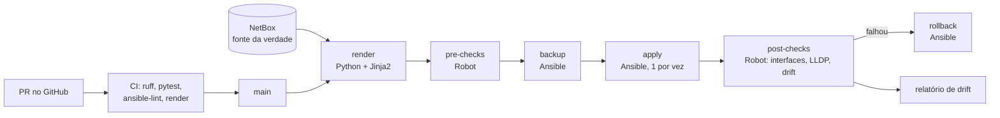
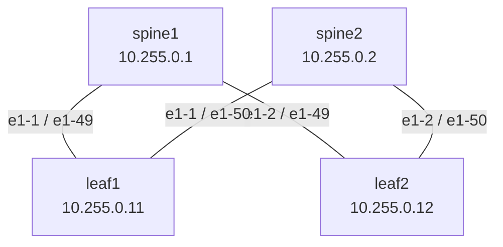

# netauto-lab

Lab de **automação de rede** com o fluxo usado em data center: o **NetBox** diz como a rede deve ser,
o código transforma isso em configuração, o **Ansible** aplica, o **Robot Framework** confere antes e
depois, e um verificador de **drift** avisa quando alguém mexe na rede fora do pipeline.

Tudo roda num fabric spine-leaf de **Nokia SR Linux** no containerlab (imagem pública, sem licença).



## O que este lab demonstra

| Requisito | Onde está |
|---|---|
| NetBox como fonte da verdade | `netauto/seed.py` (popular), `netauto/netbox_client.py` (ler), inventário dinâmico `ansible/inventory/netbox.yml` |
| Python com Requests/HTTPX | `netbox_client.py` (paginação, retry com backoff, `ensure` idempotente) e `srl_client.py` (JSON-RPC do SR Linux) |
| Ansible para mudança | `ansible/playbooks/`: backup, apply com `serial: 1` e `--diff`, rollback por `replace` |
| Pre/post-checks com Robot Framework | `robot/`: acesso, interfaces up, **cabeamento real (LLDP) contra os cabos do NetBox**, sem drift |
| Drift detection | `netauto/drift.py`: compara intenção x running, aponta `missing`, `changed` e `extra` |
| Git, PR e code review | o CI publica a configuração gerada (formato CLI) no resumo do PR, para revisar a mudança de rede e não só o código |
| Rastreabilidade e recuperação | logs JSON com `run_id` + commit, backup por execução, artefatos de 30 dias, rollback automático |
| pytest | 29 testes que rodam sem equipamento (httpx `MockTransport`) |

## Topologia



Enlaces ponto a ponto em /31 (`10.0.0.0/31` a `10.0.0.6/31`), loopback em `system0`,
gerência em `172.30.30.0/24`. Os dados de partida estão em `data/fabric.yml`.

## Como rodar

Pré-requisitos: Linux ou WSL2 com Docker, [containerlab](https://containerlab.dev/install/), Python 3.11+
e **8 GB de RAM** livres (cada SR Linux usa cerca de 1,5 GB).

```bash
cd labs/netauto-lab
make venv collections        # Python + coleções Ansible

make lab-up                  # 4 SR Linux no containerlab
make netbox-up               # NetBox em http://localhost:8000 (siga as instruções do script)

export NETBOX_URL=http://localhost:8000
export NETBOX_TOKEN=<token gerado no NetBox>
export SRL_PASSWORD='NokiaSrl1!'   # senha padrão do SR Linux no containerlab, só para o lab

make seed                    # fabric.yml -> NetBox (pode rodar quantas vezes quiser)
make deploy                  # render, pre-checks, backup, apply, post-checks
make drift                   # build/drift/report.json
```

Para ver o drift funcionando, mude algo direto no equipamento e rode `make drift`:

```bash
ssh admin@172.30.30.21   # leaf1
# enter candidate
# set / interface ethernet-1/49 description "mexeram aqui"
# commit now
```

Para ver o rollback: `make rollback RUN_ID=<run_id do backup>` (os arquivos ficam em `build/backups/`).

Sem lab no ar, dá para trabalhar só com os testes e o render a partir do YAML:

```bash
make test
.venv/bin/python -m netauto.render --source file && cat build/intents/leaf1.cli
```

## Pipeline no GitHub Actions

- **`netauto-ci.yml`** (todo PR): ruff, pytest, render, Robot dry-run, ansible-lint e syntax-check.
  A configuração gerada aparece no resumo do job.
- **`netauto-deploy.yml`** (manual): roda num **runner self-hosted** com label `netauto-lab`, na máquina
  do lab. Pede a palavra `APLICAR`, vem em modo simulação por padrão, faz rollback se o post-check falhar
  e guarda tudo (`build/`) como artefato.
- **`netauto-drift.yml`** (manual, com agendamento pronto para ligar): falha quando a rede diverge do NetBox.

Segredos do repositório: `NETBOX_TOKEN` e `SRL_PASSWORD`. Variáveis: `NETBOX_URL` e `SRL_USER`.

## Decisões

- **Intenção como dado, não como template de texto.** O render gera `{path, value}` para o JSON-RPC
  do SR Linux. Isso é testável com `==` e é exatamente o que o módulo `nokia.srlinux.config` recebe.
  O arquivo `.cli` existe só para leitura humana no PR.
- **Merge no apply, replace no rollback.** O apply só acrescenta e corrige; o drift mostra o que sobrou.
  O rollback devolve a running inteira salva antes da mudança.
- **Um equipamento por vez** (`serial: 1`, `max_fail_percentage: 0`): se o primeiro falhar, os outros não são tocados.
- **Validação antes de tudo.** IP repetido, /31 errado, interface em dois cabos ou papel inexistente
  barram o processo antes de chegar na rede (`model.validate_fabric`).
- **Os post-checks conferem o cabo de verdade.** O LLDP de cada porta tem que bater com o cabo cadastrado
  no NetBox, o que pega cabo trocado no rack.

## Estrutura

```
labs/netauto-lab/
├── topology/fabric.clab.yml     # containerlab
├── netbox/                      # sobe o NetBox local
├── data/fabric.yml              # dados de partida do NetBox
├── netauto/                     # pacote Python
│   ├── model.py                 # modelo + validação
│   ├── netbox_client.py         # API do NetBox (httpx)
│   ├── seed.py                  # popula o NetBox
│   ├── intent.py                # modelo -> intenção SR Linux
│   ├── render.py                # gera build/intents
│   ├── srl_client.py            # JSON-RPC do SR Linux
│   ├── drift.py                 # intenção x running
│   └── robot_lib.py             # keywords do Robot
├── templates/srlinux.cli.j2
├── ansible/                     # inventário NetBox + playbooks
├── robot/                       # pre/post-checks
└── tests/                       # pytest
```

## Próximos passos

- Underlay eBGP (ASN por equipamento no NetBox) e post-check de sessões BGP estabelecidas.
- `confirm_timeout` do `nokia.srlinux.config`: commit que se desfaz sozinho se o post-check não confirmar.
- Overlay EVPN/VXLAN com VLANs vindas do NetBox.
- Webhook do NetBox abrindo PR automaticamente quando a fonte da verdade mudar.
